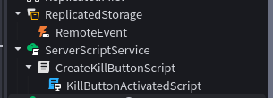

# ENG:
### This project creates a button on the player's screen. When the player clicks it, their character dies. The GUI does not disappear after death.

### Be sure to read this before use:
* *Without these steps, the project will not work.*

### Installation:
* Put the main **Script** into the **ServerScriptService** folder.
* Put the **LocalScript** (named **ClickScript**) inside the main **Script**.
* Put a **RemoteEvent** into the **ReplicatedStorage** folder.

### Example hierarchy:

---

# RU:
### Этот проект создает кнопку на экране игрока. При нажатии на неё персонаж умирает. Интерфейс (GUI) не пропадает после смерти.

### Обязательно ознакомьтесь с этим перед использованием:
* *Без правильной настройки проект работать не будет.*

### Установка:
* Положите основной **Script** в папку **ServerScriptService**.
* Положите **LocalScript** (с именем **ClickScript**) внутрь основного **Script**.
* Положите объект **RemoteEvent** в папку **ReplicatedStorage**.

### Пример иерархии:

