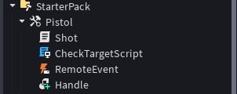

# ENG:
### This project causes the pistol to fire. When the tool is activated, CheckTargetScript checks if the player is targeting a humanoid (bot or another player) and calls a RemoteEvent to reduce the target's health by 50 HP.

### Hierarchy Preview:

### Requirements:
* A Dummy/Bot, NPC, or another player in the workspace to test the shooting mechanic.

### Installation:
* Put the **Pistol** Tool inside the **StarterPack** folder.
* Inside the **Pistol** Tool, make sure you have the following hierarchy (as shown in the image above):
  * **Shot** (Server Script)
  * **CheckTargetScript** (Local Script)
  * **RemoteEvent** (RemoteEvent object)
  * **Handle** (Part object)

---

# RU:
### Этот проект заставляет пистолет стрелять. При активации инструмента CheckTargetScript проверяет, целится ли игрок в гуманоида (бота или другого игрока), и вызывает RemoteEvent для уменьшения здоровья цели на 50 единиц.

### Внешний вид иерархии:

### Требования:
* Наличие манекена (Dummy), NPC или другого игрока на карте для проверки работы механики урона.

### Установка:
* Положите инструмент **Pistol** (Tool) в папку **StarterPack**.
* Убедитесь, что внутри инструмента **Pistol** соблюдена следующая иерархия (как на изображении выше):
  * **Shot** (Обычный серверный скрипт)
  * **CheckTargetScript** (Локальный скрипт)
  * **RemoteEvent** (Объект RemoteEvent)
  * **Handle** (Объект Part)
