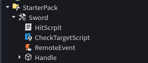

# ENG:
### This script creates a new way to earn money by clicking a button.
### Be sure to read this before use:
* Without these steps, the code will not work.

### Hierarchy :

### Installation:
* Put the main script (**ButtonEarnScript**) into the **ServerScriptService** folder.
* Inside **ButtonEarnScript**, place a **RemoteEvent** and the **ButtonActivatedScript** (as shown in the preview image above).

# RU:
### Эти скрипты создают новый способ заработка валюты — а именно получение денег по клику на кнопку.
### Обязательно ознакомьтесь с этим перед использованием:
* Без правильной настройки код работать не будет.

### Иерархия:

### Установка:
* Поместите основной скрипт (**ButtonEarnScript**) в папку **ServerScriptService**.
* Внутри скрипта **ButtonEarnScript** разместите объект **RemoteEvent** и скрипт **ButtonActivatedScript** (как показано на скриншоте выше).
