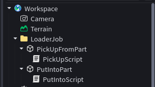
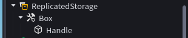

# ENG:
### This project add new way to earn money, namely Loader Job.

### Be sure to read this before use:
* *Without these steps, the project will not work*.

### Installation:
* Create **folder** in **Workspace**.
* Put in this **folder** two **parts**.
* Put in first **part** first **script**, and in second **part** second **script**.
* Create a **Tool** which have a **Handle** and put them in **ReplicatedStorage**.
* Put in **ServerScriptService** **Leaderstats** or **DataScript**(You can find them in this repository on PlayerData folder).

### Example hierarchy:

# RU:
### Этот проект создает новый метод заработка валюты, а именно работы грузчиком.

### Обязательно ознакомьтесь с этим перед использованием:
* *Без правильной настройки проект работать не будет.*

### Установка:
* Создайте **папку** в **Workspace**.
* Поместите в эту **папку** два **parts**.
* В первый **part** поместите первый **скрипт**, а во второй **part** — второй **скрипт**.
* Создайте **Tool** (инструмент), содержащий **Handle** (рукоятку), и поместите его в **ReplicatedStorage**.
* В **ServerScriptService** добавьте **Leaderstats** или **DataScript** (их можно найти в этом репозитории, в папке PlayerData).

### Пример иерархии:

